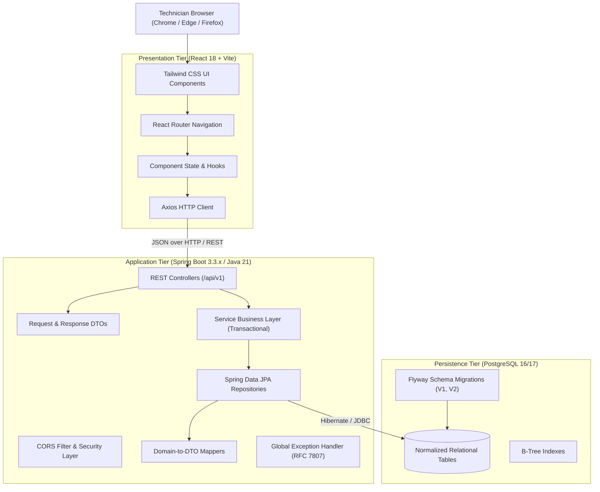

# TechFix Pro: System Architecture

## 1. Architectural Overview

TechFix Pro is built on a clean, scalable three-tier client-server architecture designed for IT field support and diagnostic workflows:

## 2. Layer Responsibilities

### Layer 1: Frontend (React + Vite + Tailwind CSS)
- **Role:** Interactive technician user interface, command search, category filtering, diagnostic workflows, and clipboard management.
- **Key Modules:**
  - `components/common`: Sidebar navigation, search bar navbar, risk indicators, toast alerts, confirmation dialogs.
  - `components/commands`: Copyable command cards, detailed technical modals with expected outputs and verification instructions.
  - `pages`: Dashboard, Windows diagnostics, Network tools, Command Library, Troubleshooting guides, Hardware auditing, Helpdesk management.
- **Safety Principle:** Enforces client-side manual copy-to-clipboard rather than executing unauthenticated arbitrary commands against client systems.

### Layer 2: Backend (Spring Boot 3.3.x REST API)
- **Role:** Core business logic, validation, data transformation, command categorization, and audit tracking.
- **Sub-packages:**
  - `com.techfixpro.controller`: REST endpoints for Dashboard, Categories, Commands, Troubleshooting Guides, Customers, Devices, and Tickets.
  - `com.techfixpro.service`: Transactional business logic, pagination, search queries, and audit recording.
  - `com.techfixpro.repository`: Spring Data JPA repositories leveraging derived methods and parameterized JPQL queries.
  - `com.techfixpro.entity`: Relational entities with automatic auditing timestamps (`createdAt`, `updatedAt`).
  - `com.techfixpro.dto`: Strict separation between HTTP payloads and database models.
  - `com.techfixpro.exception`: Centralized error interceptor producing clean, RFC-compliant error envelopes.

### Layer 3: Database (PostgreSQL)
- **Role:** Persistent relational data store.
- **Schema Management:** Automated versioned migrations managed by Flyway (`V1__initial_schema.sql`, `V2__seed_data.sql`).
- **Data Integrity:** Strict foreign key constraints, unique constraints, CHECK constraints on risk levels and ticket statuses, and performance-tuned B-Tree indexes.
