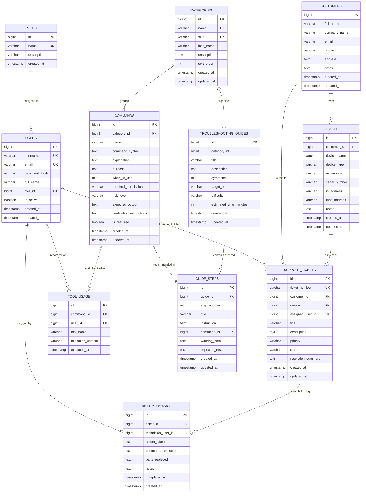

# TechFix Pro: Database Design & Entity Relationship

## 1. Entity-Relationship (ER) Diagram

## 2. Table Relationships & Design Decisions

1. **`roles` & `users`:**
   - 1-to-many relationship. Enforces Role-Based Access Control (RBAC).
   - Sensitive password hashes are stored exclusively with BCrypt encryption ($2a$ format). No plaintext credentials are ever stored or exposed.

2. **`categories` & `commands`:**
   - 1-to-many relationship with `ON DELETE CASCADE`.
   - Commands are categorized into logical technician domains: Windows, Networking, Hardware, Security, Disk Management, System Administration, PowerShell, Linux, and Printers.

3. **`troubleshooting_guides` & `guide_steps`:**
   - 1-to-many parent-child relationship.
   - Enforces unique ordering via `uq_guide_step (guide_id, step_number)`.
   - Each step optionally references a `command_id` (`ON DELETE SET NULL`), providing interactive copyable commands directly in the diagnostic workflow.

4. **`customers`, `devices`, `support_tickets`, & `repair_history`:**
   - Standard ITIL helpdesk data model:
     - Each Customer owns one or more registered Devices.
     - Support Tickets link a Customer and specific Device to an assigned Technician User.
     - Each resolved Ticket accumulates entries in `repair_history` recording exact commands run, parts replaced, and preventive recommendations.

5. **`tool_usage`:**
   - Audit trail tracking technician command copy frequency and execution context to analyze the most effective field triage tools.
